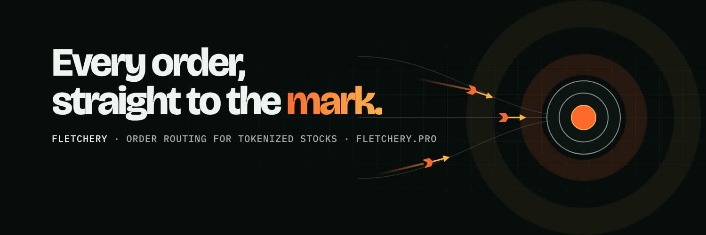
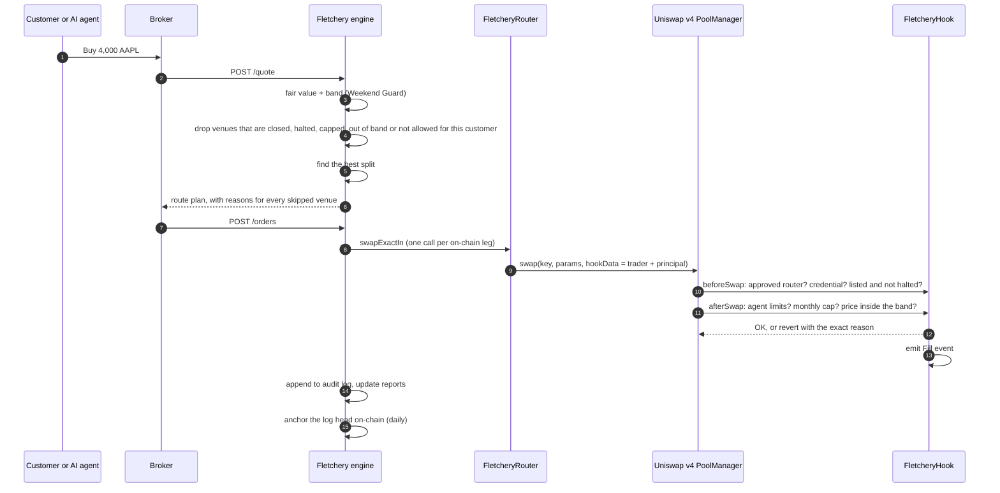

<p align="center"></p>

# Fletchery

**The routing and compliance layer for tokenized stocks.**

*Fletchery (n.): the craft of making arrows that fly true.*

[Website](https://fletchery.pro) · [Try the router](https://fletchery.pro/try) · [Documentation](docs/README.md) · [Contact](mailto:team@fletchery.pro)

---

On 17 September 2026 the US Securities and Exchange Commission (SEC) issued an exemptive order, known as the **Innovation Exemption**, that lets tokenized versions of US-listed stocks trade on-chain in permissioned AMM pools. The pools are run by a new kind of venue called a **Tokenized Securities Venue (TSV)**.

Every TSV comes with hard rules:

- limits on how many stocks it may list
- a monthly volume cap per stock
- trading halts that must match the listing exchange
- a 30-day notice period before a third party's token can trade
- full shareholder rights for token holders

Each venue also runs its own onboarding and whitelist. A broker that wants to give customers the best price has to integrate with every venue, track every cap and keep every rule. On a Saturday it also has to decide what a fair price even is, because thin pools can drift far from the stock's real value.

**Fletchery is one integration that does all of that.** A broker connects once. Fletchery then:

- quotes every venue the customer is allowed to use
- splits the order wherever splitting beats any single venue
- checks every rule before the trade, and enforces the same rules again on-chain at the moment of the trade
- writes a tamper-evident record of every decision

> **Status: working prototype. Not audited, not in production, not for real money.**
> All market data in the simulation and demo is made up. Venue names are generic placeholders. See [What is simulated](#what-is-real-and-what-is-simulated) below.

## Contents

- [What Fletchery does](#what-fletchery-does)
- [How a trade flows through it](#how-a-trade-flows-through-it)
- [What is real and what is simulated](#what-is-real-and-what-is-simulated)
- [Quick start](#quick-start)
- [Repository map](#repository-map)
- [Documentation](#documentation)
- [Why the code is public](#why-the-code-is-public)
- [Licence](#licence)
- [Disclaimer](#disclaimer)

## What Fletchery does

| Module | In one sentence | Code |
|---|---|---|
| **Routing** | Asks every eligible venue for a price and splits the order across them for the best all-in result, never past a venue's cap, safe price band or whitelist. | [`router.ts`](engine/src/execution/router.ts), [`FletcheryRouter.sol`](contracts/src/FletcheryRouter.sol) |
| **Rulebook** | The SEC's TSV rules as code: symbol limits, monthly volume caps (0.25% or 2.5% of last month's average daily volume), a three-month stop after a repeat breach, the 30-day issuer objection window and mirrored halts. | [`VenueController.sol`](contracts/src/compliance/VenueController.sol) |
| **Weekend Guard** | A fair price for every stock around the clock. When the exchange is shut, it starts from the last close and adjusts using index futures and other venues' prices. It throws out thin or manipulated prints, and pools can't trade outside a safe band around that price. | [`fairValue.ts`](engine/src/safety/fairValue.ts), [`FairValueOracle.sol`](contracts/src/safety/FairValueOracle.sol) |
| **Access** | One broker's KYC becomes a reusable on-chain credential that every Fletchery venue accepts. The credential holds a country code, an investor class and an expiry; no personal data goes on-chain. | [`CredentialRegistry.sol`](contracts/src/access/CredentialRegistry.sol) |
| **Agent limits** | Customers can let an AI agent trade for them within limits they set: per-trade size, daily total, which stocks, whether it may sell, and an expiry. The limits are enforced on-chain and there is a kill switch. | [`AgentMandates.sol`](contracts/src/access/AgentMandates.sol), [`mandates.ts`](engine/src/access/mandates.ts) |
| **Shareholder rights** | Record-date snapshots, dividends and proxy votes for token holders, including shares sitting inside trading pools. | [`StockToken.sol`](contracts/src/rights/StockToken.sol), [`RightsDistributor.sol`](contracts/src/rights/RightsDistributor.sol) |
| **Audit trail** | Every quote, route, fill and refusal goes into a hash-chained log whose head is stamped on-chain, so anyone can prove nothing was edited afterwards. | [`auditLog.ts`](engine/src/proof/auditLog.ts), [`ProofAnchor.sol`](contracts/src/proof/ProofAnchor.sol) |
| **Reports** | Regulatory-style order events, a best-execution summary and cap usage with a run-rate forecast. | [`reports.ts`](engine/src/compliance/reports.ts) |
| **Broker API** | An HTTP API a broker calls to get quotes, place orders, set agent limits, mirror halts and pull reports. | [`server.ts`](engine/src/server.ts) |

## How a trade flows through it



The engine checks every rule **before** sending an order, so customers get a clear reason instead of a failed transaction. The hook checks the same rules **again on-chain**, so a bug or a misbehaving client can't get past them. See [Architecture](docs/architecture.md).

## What is real and what is simulated

**Real and tested:**

- **Smart contracts:** 65 tests pass against Uniswap v4's real `PoolManager`. The whole suite runs twice, once with each token ordering in the pool, and one test fuzzes 256 random order sizes against the monthly cap.
- **Engine:** 20 tests cover routing, New York sessions (including daylight saving and NYSE holidays), fair value, agent limits, audit-log tamper detection, the ABI encoder and the HTTP API.
- **On-chain run:** an end-to-end run on a local chain passes 19 of 19 steps. It deploys everything, waits out the 30-day listing notice, opens a pool, then drives it from the engine. On-chain it refuses:
  - a wallet with no credential
  - an order during a halt
  - an agent over its limit
  - an agent trying to sell
  - an order that would push the price out of the band
  - an order past the monthly cap
  - a stale fair value

  It then pays a dividend on record-date balances and anchors the audit log on-chain.
- **Simulated week:** a trading week of 843 orders runs through every scenario and produces the reports and the dashboard.

**Simulated:**

- **Market data and venues:** every price, depth, cap and flow in the simulation, dashboard and website demo is made up. "Venue A", "Venue B", "Venue C" and "Offshore pool" are generic stand-ins, not real venues.
- **Venue models:** the engine models each venue as a simple constant-product pool. Real venue adapters are not built yet.
- **Reports:** the regulatory-style output uses a simplified field set, not any official schema.

**Not done yet, and needing people, partners or licences:** regulatory status, venue agreements, licensed market data, a security audit and production key management. See the [Roadmap](docs/roadmap.md).

## Quick start

You need macOS or Linux, `git`, and [Node.js 22.18 or newer](https://nodejs.org). Node runs the TypeScript directly; the engine has no runtime dependencies. The setup script installs [Foundry](https://getfoundry.sh) (`forge`, `anvil`, `cast`) if you don't have it.

```bash
git clone --recursive https://github.com/Fletchery-Pro/Fletchery.git
cd Fletchery
./scripts/setup.sh      # once: fetch submodules, install Foundry if missing
./scripts/test-all.sh   # contract tests, engine tests, simulated week, on-chain run, dashboard
```

Then open `dashboard/index.html` in a browser, or start the broker API:

```bash
cd engine && node src/server.ts          # http://localhost:8787
curl -s localhost:8787/fair-value/AAPL
curl -s -X POST localhost:8787/quote -H 'content-type: application/json' \
  -d '{"account":"us-1","symbol":"AAPL","side":"BUY","shares":500,"delivery":"TOKEN"}'
```

| Command | What it does |
|---|---|
| `cd contracts && forge test` | Smart contract tests |
| `cd engine && npm test` | Engine tests (no `npm install` needed) |
| `cd engine && npm run demo` | Simulated week; outputs to `engine/out/` |
| `./scripts/e2e.sh` | Local chain: deploy, launch a pool, drive it from the engine |
| `cd engine && npm run dashboard` | Rebuild the dashboard from the latest outputs |
| `cd engine && npm run serve` | Broker API on port 8787 |

If your network blocks compiler downloads, point `FOUNDRY_SOLC` at a local `solc` 0.8.26 binary. More detail is in [Getting started](docs/getting-started.md).

## Repository map

```
contracts/                 Solidity, built and tested with Foundry
  src/FletcheryHook.sol      Uniswap v4 hook: enforces every rule on every swap
  src/FletcheryRouter.sol    broker gateway: stamps who is trading for whom
  src/access/                Roles, CredentialRegistry, AgentMandates
  src/compliance/            VenueController (the SEC rulebook)
  src/safety/                FairValueOracle (Weekend Guard on-chain)
  src/rights/                StockToken, RightsDistributor
  src/proof/                 ProofAnchor
  test/                      Fixture.sol + Fletchery.t.sol (65 tests)
  script/                    Deploy.s.sol, Launch.s.sol
  lib/                       Uniswap v4-core and forge-std (git submodules)
engine/                    TypeScript, zero runtime dependencies
  src/execution/             venue models and the router
  src/safety/                Weekend Guard fair value
  src/market/                New York trading sessions and holidays
  src/access/                agent limits (off-chain mirror)
  src/compliance/            reports
  src/proof/                 hash-chained audit log
  src/chain/                 keccak, ABI encoder, JSON-RPC client
  src/fletchery.ts           the engine object a broker integrates with
  src/server.ts              broker HTTP API
  scripts/                   simulated week, on-chain demo, dashboard builder
  test/                      20 tests
dashboard/                 operations console (template + built page)
scripts/                   setup.sh, test-all.sh, e2e.sh
docs/                      everything explained in detail
```

## Documentation

Start with [docs/README.md](docs/README.md). The main pages:

| Page | Read it for |
|---|---|
| [What is Fletchery?](docs/what-is-fletchery.md) | The plain-English explanation: problem, product, who it's for |
| [The market and the rules](docs/market-context.md) | The SEC Innovation Exemption, and how each rule maps to code |
| [Architecture](docs/architecture.md) | Components, trade lifecycle, on-chain vs off-chain, roles |
| [Smart contracts](docs/smart-contracts.md) | Every contract: state, functions, roles, events, errors |
| [Engine](docs/engine.md) | Router algorithm, fair-value maths, sessions, audit log, reports |
| [Rules and limits reference](docs/rules-and-limits.md) | Every parameter, where it's enforced and what error it raises |
| [Broker API](docs/broker-api.md) | Endpoints with request and response examples |
| [Getting started](docs/getting-started.md) | Setup, commands, troubleshooting |
| [Testing and simulation](docs/testing.md) | What each test proves, the on-chain run and the simulated week |
| [Security model](docs/security.md) | Trust assumptions, threat model, known issues |
| [Roadmap](docs/roadmap.md) | Known limits and the path to production |
| [FAQ](docs/faq.md) and [Glossary](docs/glossary.md) | Quick answers and terms |

## Why the code is public

- **The rules require it.** The Innovation Exemption requires a TSV's smart contracts to be public and auditable, deployed on a public, permissionless blockchain. Any venue running Fletchery's hook would publish these contracts anyway.
- **Trust.** Brokers, venues, auditors and regulators can read exactly what is enforced, and how.
- **Review.** More eyes on the contracts before the formal audit means fewer surprises after it.

## Licence

The code is released under the [Business Source License 1.1](LICENSE):

- **Allowed now:** you may read, copy, modify and run it for any non-production purpose, such as research, evaluation, testing or building an integration to show us.
- **Needs a commercial licence:** production use, meaning running it for real trading or as part of a commercial service. Contact [team@fletchery.pro](mailto:team@fletchery.pro).
- **Later:** on the Change Date in the licence (26 October 2030), the code automatically becomes available under GPL-2.0-or-later.

The Uniswap v4-core and forge-std submodules keep their own licences.

## Disclaimer

Fletchery is an early-stage software project. This repository is not investment, legal or regulatory advice, and is not an offer of any security or service.

The contracts have **not been audited** and must not be used with real funds. Nothing here claims approval by, or a relationship with, any regulator, exchange, broker or venue. All example figures are simulated.

## Contact

[team@fletchery.pro](mailto:team@fletchery.pro) · [fletchery.pro](https://fletchery.pro)

We're choosing our first design partners: brokers, trading apps and tokenized-stock venues.
