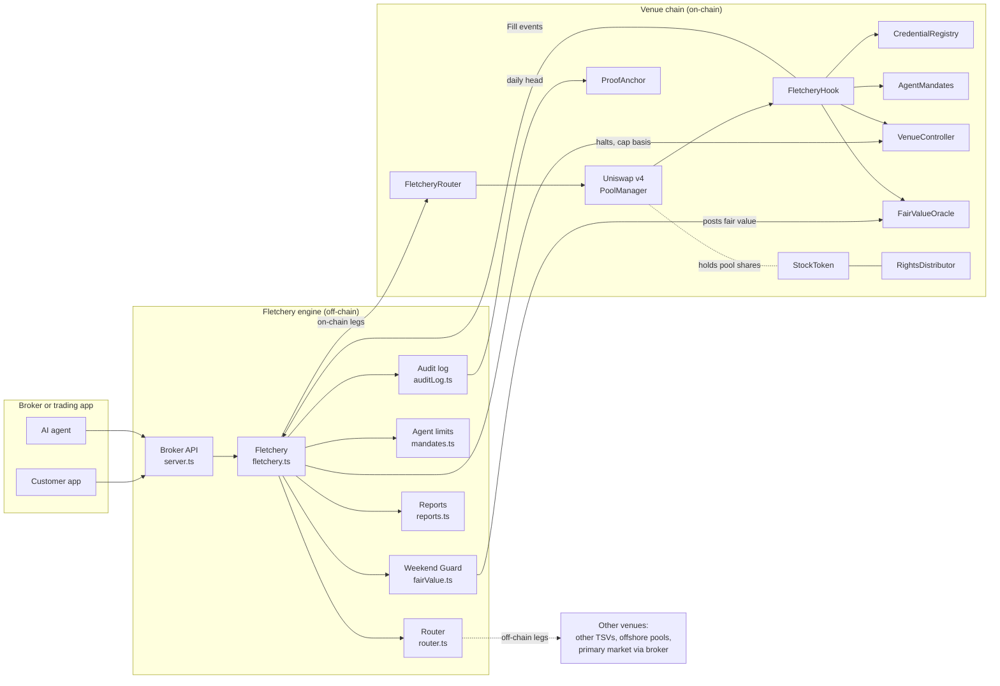

# Architecture

Fletchery has two halves:

- **The engine** (TypeScript, off-chain) decides. It prices, routes, explains, reports and keeps the audit log.
- **The contracts** (Solidity, on-chain) enforce. A Uniswap v4 hook checks every rule at the moment of every swap.

The engine checks everything first so customers get fast, readable answers. The contracts check again so the rules hold even if the engine is wrong, bypassed or compromised.

## Components

## The life of an order

1. **Order in.** A customer, or an AI agent acting for one, sends an order to the broker. The broker calls `POST /quote` or `POST /orders` on the engine.
2. **Fair value.** The engine computes the stock's fair value and the allowed band for the current New York session ([Engine › Weekend Guard](engine.md#weekend-guard-fair-value)).
3. **Agent limits.** If an agent placed the order, the engine checks the customer's mandate for that agent: stock list, sells allowed, per-trade and daily limits.
4. **Eligibility.** Every venue is checked and either kept or skipped with a reason. A venue is skipped when:
   - the stock isn't listed there
   - it's halted
   - the venue is closed this session
   - the customer's country isn't allowed
   - the venue hasn't whitelisted the router
   - the cap is used up
   - the pool's price is outside the band and the trade would make it worse
5. **Route.** The router searches combinations of eligible venues and fills the order in slices at the best marginal price. Fees, half-spread, gas, cap headroom, the band and any limit price all count ([Engine › Router](engine.md#router)).
6. **Execute.** On-chain legs go through `FletcheryRouter.swapExactIn`. Off-chain legs, such as the primary market, go through the broker's existing route.
7. **On-chain checks.** Inside the swap, Uniswap v4 calls `FletcheryHook` before and after. The hook checks, in order:
   1. the order came through an approved router
   2. the beneficial owner holds a live credential from an allowed country and investor class
   3. the stock is listed, not halted and not stopped
   4. if an agent is trading, it is inside the customer's mandate
   5. the fill fits under the monthly cap
   6. the post-trade price is inside the fair-value band, or has moved back toward it

   If any check fails, the whole swap reverts with a specific error. Otherwise the hook emits a `Fill` event.
8. **Record.** The engine appends `ORDER`, `QUOTE`, `FILL` or `REJECT` entries to its hash-chained audit log, and updates the order events, best-execution report and cap report.
9. **Anchor.** Once a day the engine writes the audit-log head to `ProofAnchor`, fixing history up to that point.

## On-chain vs off-chain: who does what

| Concern | Engine (off-chain) | Contracts (on-chain) |
|---|---|---|
| Fair value | Computes it from close, futures and venue prices; posts it | Stores it; derives the band; **fails closed** if stale |
| Venue choice and splitting | Yes | No (each swap is one pool) |
| Credentials | Reads them for eligibility | **Enforces** them on every swap and liquidity add |
| Agent limits | Pre-checks, with readable reasons | **Enforces** and records daily spend |
| Monthly caps | Sizes orders to headroom; forecasts exhaustion | **Enforces** pre-fill; meters volume |
| Halts | Receives the exchange feed; mirrors it | **Enforces** on every swap |
| Listings and notice | — | Notice, objection, activation, symbol limit |
| Dividends and votes | — | Snapshots, claims, voting |
| Audit trail | Hash-chained log | Anchors of the log head |
| Reports | Order events, best execution, cap usage | `Fill` events as the source |

## Identity: trader and principal

Every on-chain trade carries two identities:

- **trader:** whoever called the router (`msg.sender`)
- **principal:** the beneficial owner whose funds and shares move

Normally these are the same. When an AI agent trades for a customer, the agent calls `swapExactIn(..., onBehalfOf = customer, ...)`. The router stamps `(trader = agent, principal = customer)` into the swap's `hookData`.

The router always sets `trader` to its own caller, so nobody can claim to be someone else. The hook only accepts `hookData` from routers it has approved. It then:

- requires the **principal** to hold a credential (the agent needs none of its own)
- if `trader ≠ principal`, requires a live mandate from that principal for that agent, and records the spend

An attacker who sets `onBehalfOf` to a victim gets `NoMandate` and the swap reverts. See [Security model](security.md).

## Design principles

- **Fail closed.** A missing or stale fair value, a missing cap basis or an unknown pool stops trading rather than letting it through.
- **Defence in depth.** Every rule is checked off-chain for a good user experience, and on-chain for safety.
- **Repairing trades are always allowed.** A trade that moves a dislocated pool *back toward* fair value is never blocked, even if the post-trade price is still outside the band. Blocking it would trap the pool at a bad price.
- **No personal data on-chain.** Credentials hold only a country code, an investor class, an expiry and a hash pointing to the attester's own record.
- **One hook, many venues.** Any venue can run `FletcheryHook`. Brokers integrate once and reach every venue that does.
- **Small, separately auditable modules.** Each contract does one job and shares only the minimal `Roles` base.
- **Plain, readable reasons.** Every refusal, on-chain or off, comes with a specific reason a customer or regulator can understand.

## Roles and who holds them

In the demo deployment ([`Deploy.s.sol`](../contracts/script/Deploy.s.sol)) a single operator key holds most roles. In production each would be a separate, tightly controlled key or service.

| Contract | Role | Held by | Can |
|---|---|---|---|
| every module | `owner` | venue operator (multisig in production) | Grant roles; module-specific admin. Ownership transfer takes two steps. |
| `CredentialRegistry` | `ATTESTER` | brokers, KYC providers | Issue and refresh credentials; revoke their own |
| `AgentMandates` | `ENFORCER` | `FletcheryHook` | Consume mandate spend during swaps |
| `VenueController` | `LISTING_ADMIN` | venue operator | Notice, activate and delist symbols |
| `VenueController` | `DATA_ORACLE` | engine (market-data service) | Post the prior-month ADV cap basis |
| `VenueController` | `HALT_ORACLE` | engine (halt feed) | Mirror symbol and market-wide halts |
| `VenueController` | `METER` | `FletcheryHook` | Record volume against the cap |
| `FairValueOracle` | `REPORTER` | engine (Weekend Guard) | Post fair value and confidence |
| `ProofAnchor` | `ANCHORER` | engine | Anchor audit-log heads |
| `StockToken` | `TRANSFER_AGENT` | transfer agent | Mint, burn, take record-date snapshots |
| `RightsDistributor` | `CORPORATE_ACTIONS` | transfer agent or issuer agent | Declare dividends, open votes |
| `FletcheryHook` | `owner` | venue operator | Register pools, approve routers, block countries, set minimum investor class |

## Deployment

Uniswap v4 reads a hook's permissions from the low bits of its address, so the hook is deployed with `CREATE2` using a mined salt. The salt gives an address whose flags are exactly `BEFORE_INITIALIZE | BEFORE_ADD_LIQUIDITY | BEFORE_SWAP | AFTER_SWAP`.

The demo deploys in two phases, because a listing can't go live until its 30-day notice has run:

1. **[`Deploy.s.sol`](../contracts/script/Deploy.s.sol)** deploys every module, wires the roles, issues demo credentials, deploys the stock token and a demo dollar token, mines and deploys the hook, approves the router, registers the pool and files the AAPL listing notice.
2. *(30 days pass. In the local demo the chain clock is moved forward.)*
3. **[`Launch.s.sol`](../contracts/script/Launch.s.sol)** activates the listing, posts the cap basis and a fair value, initialises the pool and adds liquidity.

[`scripts/e2e.sh`](../scripts/e2e.sh) runs both phases on a local chain and then drives the venue from the engine ([Testing](testing.md#the-on-chain-run)).
