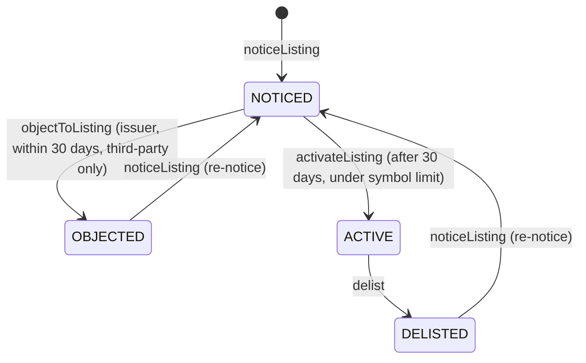

# Smart contracts

All contracts are in [`contracts/src`](../contracts/src). They are written in Solidity 0.8.26, target the Cancun EVM (the hook uses transient storage) and build against Uniswap [v4-core](https://github.com/Uniswap/v4-core).

> **Not audited.** Do not deploy these contracts with real funds. See [Security model](security.md).

| Contract | Module | Lines | Purpose |
|---|---|---|---|
| [`FletcheryHook`](#fletcheryhook) | Execution | ~340 | Uniswap v4 hook that enforces every rule on every swap |
| [`FletcheryRouter`](#fletcheryrouter) | Execution | ~120 | Broker gateway that stamps who is trading for whom |
| [`Roles`](#roles) | Shared | ~55 | Owner and role-based access control |
| [`CredentialRegistry`](#credentialregistry) | Access | ~95 | Reusable, non-transferable investor credentials |
| [`AgentMandates`](#agentmandates) | Access | ~110 | Spending limits for AI agents |
| [`VenueController`](#venuecontroller) | Compliance | ~245 | The TSV rulebook: listings, caps, breaches, halts |
| [`FairValueOracle`](#fairvalueoracle) | Safety | ~80 | Weekend Guard fair value and bands |
| [`StockToken`](#stocktoken) | Rights | ~170 | Permissioned share token with record-date snapshots |
| [`RightsDistributor`](#rightsdistributor) | Rights | ~140 | Dividends and proxy votes |
| [`ProofAnchor`](#proofanchor) | Proof | ~50 | On-chain anchors of the audit log |

Units used throughout:

- **Prices** are USD with 8 decimals (`priceE8`), so `200e8` means $200.00.
- **Basis points:** 10,000 bps = 100%.
- **Stock tokens** have 18 decimals.
- **The demo cash token** (`dUSD`) has 6 decimals.
- **Symbols** are stored as `bytes32`, so `"AAPL"` is right-padded with zero bytes.

---

## FletcheryHook

[`src/FletcheryHook.sol`](../contracts/src/FletcheryHook.sol)

The hook is attached to every pool a venue runs. Uniswap v4's `PoolManager` calls it around pool actions.

**Hook permissions:**

| Permission | Used for |
|---|---|
| `beforeInitialize` | Only the hook owner can create a pool, and only for a registered pool. |
| `beforeAddLiquidity` | The liquidity provider must hold a valid credential. |
| `beforeSwap` | Router approval, the principal's credential, and whether the symbol can trade. Also saves the pre-swap price in transient storage. |
| `afterSwap` | Agent mandate, monthly cap and fair-value band. Then emits the `Fill` event. |

All other hook entry points revert with `HookNotImplemented`. Removing liquidity is not gated, so LPs can always withdraw.

**Configuration (owner only):**

| Function | Effect |
|---|---|
| `registerPool(key, symbol, stockIsCurrency0, stockDec, cashDec)` | Declares which token is the stock and the decimals for price maths. A pool must be registered before it can be initialised. |
| `setRouter(router, approved)` | Approves or removes a router. Only approved routers can trade or add liquidity. |
| `setJurisdictionBlocked(code, blocked)` | Blocks a country (ISO 3166-1 numeric code). |
| `setMinClass(class)` | Sets the minimum investor class: `RETAIL`, `ACCREDITED` or `INSTITUTIONAL`. |

**The checks on a swap, in order:**

1. `_actors`: `msg.sender` (the router) must be approved; decodes `(trader, principal)` from `hookData`.
2. `_requireEligible(principal)`: valid credential, country not blocked, class at or above the minimum.
3. `venue.requireTradable(symbol)`: listing active, no market-wide halt, no symbol halt, not stopped.
4. *(after the swap, once amounts are known)* If `trader ≠ principal`: `mandates.consume(...)` with the cash notional.
5. `venue.recordVolume(symbol, stockAmount)`: reverts if the fill would exceed the cap.
6. `_checkBand`: reads `oracle.band(symbol)`, which reverts if the fair value is stale or missing. It then compares the post-swap pool price with the band. If the price is outside the band, the trade is allowed only if it ended **closer** to the band than it started (`dPost < dPre`).

A revert anywhere in `afterSwap` unwinds the whole swap.

**`Fill` event:**

```solidity
event Fill(PoolId indexed id, bytes32 indexed symbol, address indexed trader,
           address principal, address router, bool isSell,
           uint256 stockAmount, uint256 cashAmount, uint256 priceE8, uint256 fairValueE8);
```

The engine and reporting pipeline consume these events. `fairValueE8` is the fair value in force at the time of the fill, so every fill can be compared with fair value later.

**Errors:**

| Error | Meaning |
|---|---|
| `NotPoolManager` | A hook function was called by something other than the `PoolManager`. |
| `HookNotImplemented` | An unused hook entry point was called. |
| `PoolNotRegistered` | The pool hasn't been registered with the hook. |
| `RouterNotApproved(router)` | The swap or liquidity change came through an unapproved router. |
| `NoCredential(account)` | The account holds no valid credential. |
| `JurisdictionNotAllowed(code)` | The account's country is blocked. |
| `InvestorClassTooLow` | The account's investor class is below the minimum. |
| `PriceOutOfBand(priceE8, lowE8, highE8)` | The trade would leave the pool outside the fair-value band without improving it. |
| `NotOperator` | Someone other than the hook owner tried to initialise a pool. |

**Price maths.** `_priceE8` converts the pool's `sqrtPriceX96` into USD per whole share with 8 decimals. It handles either token ordering and the decimals of each token. The test suite runs every test twice, once with the stock as `currency0` and once as `currency1`, to prove both orderings work.

## FletcheryRouter

[`src/FletcheryRouter.sol`](../contracts/src/FletcheryRouter.sol)

This is the entry point brokers and wallets call. It uses the v4 `unlock` → `unlockCallback` flow, then settles or takes each currency.

| Function | Notes |
|---|---|
| `swapExactIn(key, zeroForOne, amountIn, minOut, onBehalfOf, deadline)` | Exact-input swap. If `onBehalfOf` is zero, the caller trades for themselves. Otherwise the caller is an agent and `onBehalfOf` is the principal: the principal pays and receives, and the hook enforces the principal's mandate. Reverts with `Expired` after the deadline and `Slippage(out, minOut)` below the minimum output. Emits `Routed`. |
| `modifyLiquidity(key, params, deadline)` | Adds or removes liquidity for the caller. Adding requires a credential, which the hook checks. |

`hookData` is always `abi.encode(msg.sender, principal)`. Because the router writes `msg.sender` itself, the trader identity can't be spoofed.

Tokens are pulled with `transferFrom` from the payer, so the payer must have approved the router.

## Roles

[`src/access/Roles.sol`](../contracts/src/access/Roles.sol)

A minimal access-control base shared by every module:

- `owner`, with a **two-step** transfer (`transferOwnership` then `acceptOwnership`) so a typo can't lock a venue out.
- `hasRole[role][account]`, set by the owner with `setRole`.
- `onlyOwner` and `onlyRole(role)` modifiers.
- Errors: `NotOwner`, `MissingRole(role, account)` and `ZeroAddress`.

## CredentialRegistry

[`src/access/CredentialRegistry.sol`](../contracts/src/access/CredentialRegistry.sol)

Reusable investor credentials. A broker or KYC provider (an **attester**) checks a customer once and writes a credential. Every venue that trusts that attester then accepts it.

```solidity
struct Credential {
    uint64 expiry;           // unix seconds
    uint16 jurisdiction;     // ISO 3166-1 numeric: 840 = US, 826 = UK, 276 = DE …
    InvestorClass class;     // NONE, RETAIL, ACCREDITED, INSTITUTIONAL
    bool revoked;
    address attester;
    bytes32 kycRef;          // hash pointing to the attester's off-chain record
}
```

| Function | Who | Notes |
|---|---|---|
| `issue(account, jurisdiction, class, expiry, kycRef)` | `ATTESTER` | Issues or refreshes a credential. Rejects class `NONE`, a past expiry or jurisdiction 0. The latest attester becomes responsible for the credential. |
| `revoke(account, reason)` | issuing attester or owner | Marks the credential revoked. The owner path is for cases such as a regulator's request. |
| `isValid(account)` | view | Valid only if not revoked, not expired, class isn't `NONE`, **and the attester still holds `ATTESTER`**. Removing an attester's role therefore invalidates every credential it issued, in one transaction. |
| `check(account)` | view | Returns `(valid, jurisdiction, class)` in one call, for the hook's hot path. |

No personal data is stored on-chain.

## AgentMandates

[`src/access/AgentMandates.sol`](../contracts/src/access/AgentMandates.sol)

A customer (the **principal**) grants an AI agent a mandate. The mandate is keyed by `(principal, agent)`.

```solidity
struct Mandate {
    uint128 maxPerTrade;  // cash units
    uint128 dailyLimit;   // cash units per UTC day
    uint64 expiry;
    bool allowSells;
    bool anySymbol;       // false → only allow-listed symbols
    bool active;
}
```

| Function | Who | Notes |
|---|---|---|
| `setMandate(agent, maxPerTrade, dailyLimit, expiry, allowSells, anySymbol)` | principal | Creates or replaces the mandate. |
| `setSymbol(agent, symbol, allowed)` | principal | Edits the allow-list. |
| `revoke(agent)` | principal | **Kill switch:** deletes the mandate immediately. |
| `canSpend(principal, agent, symbol, isSell, notional)` | view | Pre-check that returns `(ok, reason)` with the exact error encoded. |
| `consume(...)` | `ENFORCER` (the hook) | Runs `canSpend`, reverts with the exact reason if it fails, otherwise adds the spend to `spentOnDay[principal][agent][day]`. |

Errors: `NoMandate`, `MandateExpired`, `SymbolNotAllowed(symbol)`, `SellsNotAllowed`, `PerTradeLimit(notional, limit)` and `DailyLimit(wouldSpend, limit)`. The day is `block.timestamp / 1 days`, in UTC.

## VenueController

[`src/compliance/VenueController.sol`](../contracts/src/compliance/VenueController.sol)

The SEC TSV rulebook. One instance per venue, constructed with its tier:

| Tier | `capBps` | `maxSymbols` |
|---|---|---|
| 1 | 25 (0.25%) | 75 |
| 2 | 250 (2.5%) | 250 |

Any other tier reverts with `BadTier`.

**Listings:**



| Function | Who | Notes |
|---|---|---|
| `noticeListing(symbol, token, issuer, issuerSponsored)` | `LISTING_ADMIN` | Starts the 30-day notice. |
| `objectToListing(symbol)` | the issuer | Only for third-party tokens, and only within `NOTICE_PERIOD` (30 days). |
| `activateListing(symbol)` | `LISTING_ADMIN` | Only after the notice period, and only if `activeSymbols < maxSymbols`. |
| `delist(symbol)` | `LISTING_ADMIN` | Frees a symbol slot. |

**Caps:**

| Function | Who | Notes |
|---|---|---|
| `setCapBasis(symbol, priorMonthAdv)` | `DATA_ORACLE` | Posts last month's consolidated ADV (in 18-decimal token units). This month's cap is `priorMonthAdv × capBps / 10,000`. If volume already exceeds a newly lowered cap, that counts as a breach. |
| `headroom(symbol)` | view | Returns `(remaining, cap, used)` and never reverts. Routers use it to size orders. |
| `recordVolume(symbol, amount)` | `METER` (the hook) | Checks the symbol can trade, then requires a cap basis for the current month (`NoCapBasis` otherwise: fails closed). Resets the counter on a new month, and reverts `CapExceeded(symbol, wouldBe, cap)` rather than going over. |
| `monthKey(ts)` | pure | `year × 12 + month` in UTC, using Howard Hinnant's civil-from-days algorithm. Caps reset on the 1st. |

**Breaches:**

- Recorded only by `setCapBasis` on a downward revision, because trading can't cross the cap.
- A breach within `BREACH_LOOKBACK` (365 days) of the previous one sets `stoppedUntil = now + STOP_PERIOD` (90 days).
- Emits `CapBreached` and `SymbolStopped`.

**Halts:**

- `setHalt(symbol, halted, reason)` and `setMarketWideHalt(halted, reason)` are restricted to `HALT_ORACLE`.
- Reasons are short codes such as `"LULD"`, `"T1"` or `"MWCB"`.

`requireTradable(symbol)` reverts with `NotActive`, `Halted(symbol, reason)` (symbol `"*"` for market-wide) or `Stopped(symbol, until)`.

## FairValueOracle

[`src/safety/FairValueOracle.sol`](../contracts/src/safety/FairValueOracle.sol)

Weekend Guard on-chain. The engine posts a fair value per symbol:

```solidity
struct Quote { uint128 priceE8; uint32 confidenceBps; uint64 updatedAt; Session session; }
enum Session { CLOSED, OVERNIGHT, EXTENDED, REGULAR }
```

Each session has a band policy: a base width, plus the quote's own confidence, and a maximum age.

| Session | Base width | Max age | When (ET) |
|---|---|---|---|
| `REGULAR` | ±3% (300 bps) | 120 s | 09:30–16:00 on trading days |
| `EXTENDED` | ±5% (500 bps) | 300 s | 04:00–09:30 and 16:00–20:00 |
| `OVERNIGHT` | ±7% (700 bps) | 600 s | 20:00–04:00 between trading days |
| `CLOSED` | ±10% (1,000 bps) | 1,800 s | weekends and holidays |

The defaults are set in the constructor. The owner can change them with `setPolicy`.

- `band(symbol)` returns `(lowE8, highE8, midE8)`, where width = base + confidence, capped at 99.99%.
- It reverts `NoFairValue` or `StaleFairValue`, which means trading **fails closed** when the engine stops posting.
- `post` is restricted to `REPORTER`.

## StockToken

[`src/rights/StockToken.sol`](../contracts/src/rights/StockToken.sol)

A permissioned ERC-20-style token for one share of an underlying stock, held by a transfer agent.

- **Who can hold it:** only accounts with a valid credential, or approved **system** contracts (`isSystem`, for example the `PoolManager`, routers and the distributor), can hold or receive it. Both sides of every transfer are checked (`NotEligible`).
- **Mint and burn:** `mint` and `burn` are restricted to `TRANSFER_AGENT`. They represent converting between a brokerage position and a wallet token.
- **Record dates:** `snapshot()` (also `TRANSFER_AGENT`) fixes a record date and returns its id.
  - Balances are checkpointed lazily, like OpenZeppelin's snapshot pattern: the pre-change balance is written the first time an account changes after a snapshot.
  - `balanceOfAt(account, id)` and `totalSupplyAt(id)` read historical values with a binary search.

## RightsDistributor

[`src/rights/RightsDistributor.sol`](../contracts/src/rights/RightsDistributor.sol)

Dividends and proxy votes from record-date snapshots.

| Function | Who | Notes |
|---|---|---|
| `declareDividend(token, snapshotId, cash, amountPerShareE18, payableAt)` | `CORPORATE_ACTIONS` | Pulls the full funding up front: `totalSupplyAt × amountPerShare`. |
| `claim(id, holder)` | the holder, or the holder's beneficiary | Pays `balanceOfAt(holder, snapshot) × amountPerShare`. A **system holder**, such as the `PoolManager` holding LPs' shares, is claimed by its registered `beneficiaryOf`, which passes the money through, so a share sitting in a pool never loses its dividend. |
| `openVote(token, snapshotId, proposalHash, deadline)` | `CORPORATE_ACTIONS` | `proposalHash` is the hash of the issuer's proxy item. |
| `castVote(id, support)` | holders | 0 = against, 1 = for, 2 = abstain. Weight = record-date balance. One vote per holder. |

Errors: `NotPayableYet`, `AlreadyClaimed`, `NothingToClaim`, `NotBeneficiary`, `VoteClosed`, `AlreadyVoted` and `BadSupport`.

## ProofAnchor

[`src/proof/ProofAnchor.sol`](../contracts/src/proof/ProofAnchor.sol)

Stores the head of the engine's audit log for each batch.

- `anchor(head, fromSeq, toSeq, uri)` is restricted to `ANCHORER`. Batches must be **contiguous**: `fromSeq` must equal the previous `toSeq + 1`, otherwise it reverts with `NonContiguous`, and `toSeq < fromSeq` reverts with `BadRange`.
- `uri` says where the batch can be fetched.
- `isAnchored(head)` and `count()` are views.

How to use the anchors to prove the log hasn't been edited is explained in [Engine › Audit log](engine.md#audit-log).

## Build settings

From [`foundry.toml`](../contracts/foundry.toml):

- `solc 0.8.26`, `evm_version = cancun`
- optimiser on with 200 runs, `via_ir = false`, `bytecode_hash = none`
- remappings to `lib/v4-core` and `lib/forge-std`
- 256 fuzz runs
